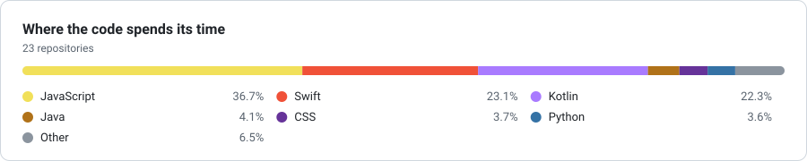
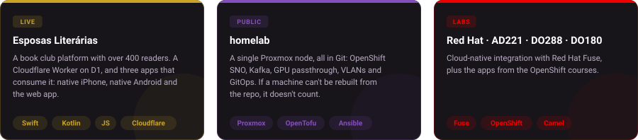
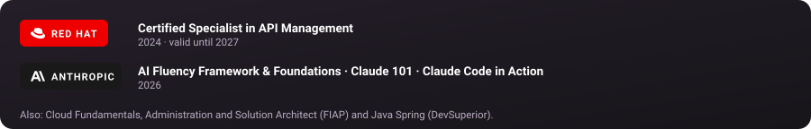
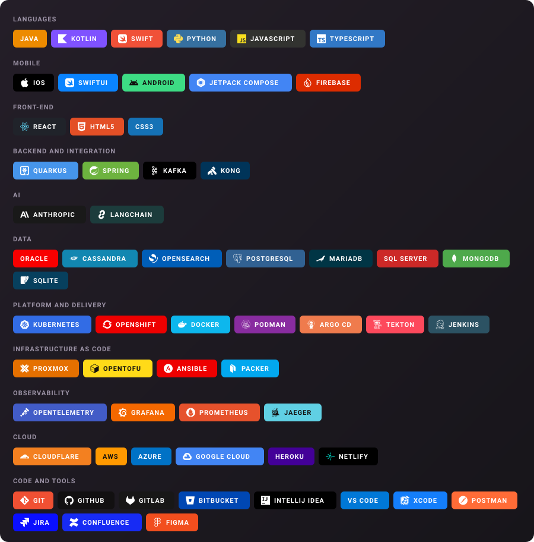

  

  <picture>
    <source media="(prefers-color-scheme: dark)"
            srcset="https://raw.githubusercontent.com/sergio-figueiredo/sergio-figueiredo/output/linguagens-escuro.svg">
    
  </picture>

---

[esposasliterarias.com](https://esposasliterarias.com) · [homelab](https://github.com/sergio-figueiredo/homelab) · [AD221](https://github.com/sergio-figueiredo/AD221-apps) · [DO288](https://github.com/sergio-figueiredo/DO288-apps) · [DO180](https://github.com/sergio-figueiredo/DO180-apps)

> Most of what I build is microservice architecture for internal systems, and it lives in
> private GitLab. What's here is what I can show.

---

---

  

---

<picture>
  <source media="(prefers-color-scheme: dark)"
          srcset="https://raw.githubusercontent.com/sergio-figueiredo/sergio-figueiredo/output/snake-escuro.svg">
  
</picture>

---

